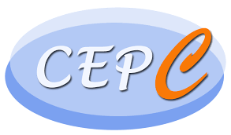
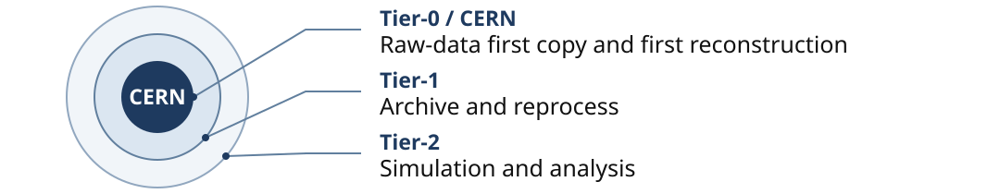
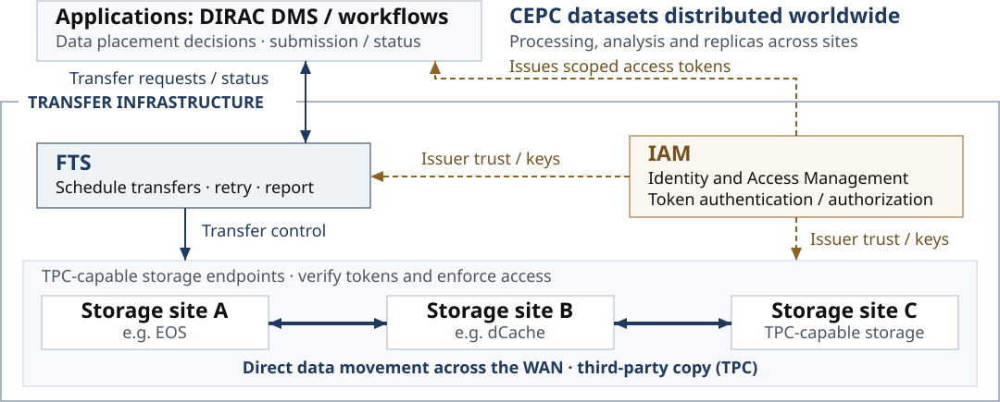
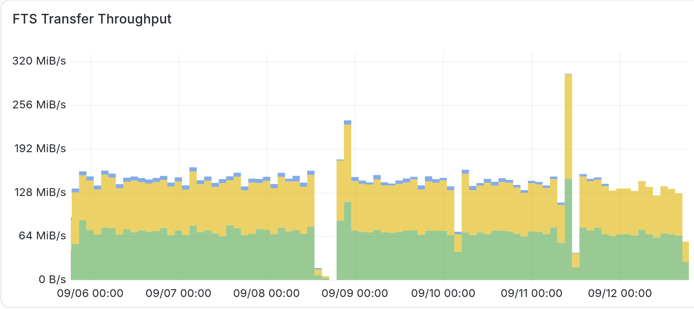
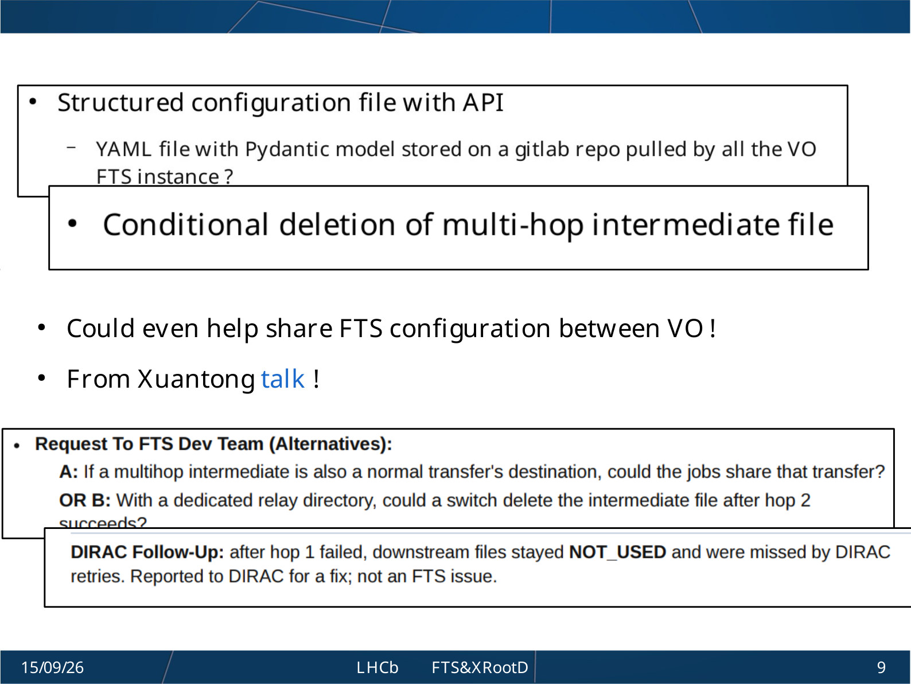

CEPC2026 · OFFLINE COMPUTING & SOFTWARE

Grid Data Transfer Infrastructure for CEPC

IHEP operations, FTS4 tests and a CEPC validation plan

<strong>Xuantong Zhang</strong> Xiaomei Zhang · Xiao Han

Institute of High Energy Physics Chinese Academy of Sciences

<footer>Shanghai · 24 October 2026CEPC2026 · 01 / 22</footer>

---

REPORT OUTLINE

<h1>Outline</h1>

01IntroductionCEPC transfer needs and IHEP experience

02FTS4From FTS3 operations to FTS4 qualification

03TPCDirect data movement between storage sites

04IAMIdentity, tokens and CEPC plans

05SummaryFrom JUNO rehearsal to CEPC validation

<footer>CEPC2026 · Offline Computing &amp; SoftwareCEPC2026 · 02 / 22</footer>

---

01 / 05

Introduction

CEPC transfer needs and IHEP experience

IntroductionFTS4TPCIAMSummary

<footer>CEPC2026 · Offline Computing &amp; SoftwareCEPC2026 · 03 / 22</footer>

---

INTRODUCTION · SHARED COMPUTING AND STORAGE

<h1>Why grid data transfer?</h1>

LHC data processing and storage exceed a single centre’s capacity.

Worldwide LHC Computing Grid (WLCG)

Simplified core tier roles · original illustration based on CERN/WLCG

Workflows place jobs; transfers deliver data between sites.

<strong>CEPC plans distributed computing.</strong><small>First-five-year estimates · CEPC TDR (2025)</small>

460 PB disk

460 PB tape

Transfers deliver input datasets, return outputs and maintain replicas.

<footer>Sources: <a href="https://wlcg-public.web.cern.ch/tiers/" style="color:inherit">CERN/WLCG tiers</a> · <a href="https://arxiv.org/abs/2510.05260" style="color:inherit">CEPC Detector TDR</a> · Table 13.1; §§13.6–13.7CEPC2026 · 04 / 22</footer>

---

CEPC · WORLDWIDE DATASET DISTRIBUTION

<h1>CEPC grid data transfer model</h1>

Planned token-based transfer model for CEPC, shown with example storage sites.

<footer>Sources: <a href="https://arxiv.org/abs/2510.05260" style="color:inherit">CEPC Detector TDR §13.7</a> · <a href="https://fts3-docs.web.cern.ch/fts3-docs/docs/overview.html" style="color:inherit">FTS documentation</a> · <a href="https://indigo-iam.github.io/v/current/docs/overview/" style="color:inherit">INDIGO IAM</a>CEPC2026 · 05 / 22</footer>

---

JUNO · OPERATING EXPERIENCE

<h1>JUNO: operating experience for CEPC</h1>

IHEP-CC deploys and operates the FTS service for JUNO.

<strong>Over 10 years</strong>Serving JUNO since its construction phase.

Raw, simulation and analysis data transfers across four major sites.

JUNO · 2026 year to date · reported 14 Sep 2026

<strong>11.65 <small>PB</small></strong>Data transferred

<strong>6,333,642</strong>Files transferred

Cumulative transfer volume and file count.

The same IHEP service also supports CEPC.

<footer>Transfer totals: <a href="https://indico.cern.ch/event/1639200/contributions/7225206/attachments/3342094/5990032/FTS_IHEP_v2.pdf" style="color:inherit">FTS at IHEP</a> · 14 Sep 2026 · p.6CEPC2026 · 06 / 22</footer>

---

02 / 05

FTS4

From FTS3 operations to FTS4 qualification

IntroductionFTS4TPCIAMSummary

<footer>CEPC2026 · Offline Computing &amp; SoftwareCEPC2026 · 07 / 22</footer>

---

FTS AT IHEP · SERVICE AND MONITORING

<h1>FTS3 operation and monitoring at IHEP</h1>

FTS3 server 3.14.5 · dedicated RPM deployment · VOMS proxies in production

September 2026 service snapshot; JWT workflows are under test.

<strong>FTS events</strong>fts-activemq
<b>→</b>
<strong>ActiveMQ</strong>
<b>→</b>
<strong>MonPipe</strong>IHEP · STOMP consumer
<b>→</b>
<strong>Elasticsearch</strong>Shared service
<b>→</b>
<strong>Grafana</strong>

<h2>Operators can follow</h2>
Transfer volume, file counts, rates, success and failures.
<h2>Filter the full dashboard</h2>
By site, endpoint and workload.

Workshop snapshot · 6–12 Sep 2026

<footer>Source: <a href="https://indico.cern.ch/event/1639200/contributions/7225206/attachments/3342094/5990032/FTS_IHEP_v2.pdf" style="color:inherit">FTS Status and Future Plan at IHEP</a> · September 2026 · pp.4, 11–13CEPC2026 · 08 / 22</footer>

---

FTS AT IHEP · OPERATIONS AND COOPERATION

<h1>JUNO operations contribute to FTS development</h1>

JUNO operations exposed problems IHEP handled locally or with FTS developers. Joint work led to code fixes and features developed from accepted requests.

<table class="fts-ops-issues"><thead><tr><th>Issue in JUNO operations</th><th>Local response</th></tr></thead><tbody><tr><td>Bursts strain storage endpoints.</td><td>Tune concurrency at host, storage and link levels.</td></tr><tr><td>Relay and normal replicas compete to write the same file.</td><td>Use a dedicated relay directory. Cleanup remains manual.</td></tr></tbody></table>

Proposed to FTS: reuse the first hop, or delete the relay copy after hop 2 succeeds.

LHCb explicitly cited the IHEP relay case in its cleanup discussion.

Project support is available to invite FTS developers to IHEP over the next two years for deployment and upgrade discussions.

<footer>Cases: <a href="https://indico.cern.ch/event/1639200/contributions/7225206/attachments/3342094/5990032/FTS_IHEP_v2.pdf" style="color:inherit">FTS at IHEP</a> · pp.8–9; citation: <a href="https://indico.cern.ch/event/1639200/contributions/7226160/attachments/3343074/5992121/FTS4LHCb.pdf" style="color:inherit">LHCb &lt;3 FTS[34]</a> · pp.8–9CEPC2026 · 09 / 22</footer>

---

FTS4 · PREPARING FOR RUN 4

<h1>Why the transfer service needs FTS4</h1>

HL-LHC / Run 4, around 2030, brings more data to record and distribute.

<strong>50%</strong>

of expected Run-4 transfer rates
DC27 planning target, subject to available hardware.

<h2>Larger workloads expose FTS3's design limits</h2>
Starved links and unpredictable priorities delay transfers. Scheduling and monitoring compete for database resources as queues grow.

<h2>FTS4 redesigns scheduling and the transfer engine</h2>
Designed to share capacity fairly and keep queued tasks progressing.

<footer>Sources: <a href="https://home.cern/science/accelerators/hilumi-lhc/" style="color:inherit">CERN HiLumi</a> · <a href="https://indico.cern.ch/event/1639200/contributions/7225209/attachments/3343286/5992497/FTSandXRoot_workshop_DC27_planning.pdf" style="color:inherit">Data Challenge 2027</a> · <a href="https://indico.cern.ch/event/1639200/contributions/7264061/attachments/3343312/5992630/FTS4_DC27_Status_3.pptx" style="color:inherit">FTS4 for DC27</a>CEPC2026 · 10 / 22</footer>

---

FTS4 · CORE CHANGES

<h1>What changes in FTS4</h1>

FTS4 redesigns the File Transfer Service for larger workloads.

<h2>Fair, explainable scheduling</h2>

Links, experiments and activities get defined turns and shares.

A deterministic order helps operators explain waiting times.

<h2>An engine for larger queues</h2>

PostgreSQL and reworked workers support larger queues.

Batch updates speed writes; consistent locking fixes identified deadlocks.

<h2>Persistent tape workflows</h2>

Per-endpoint requests and resilient polling support long recalls.

Failed polls can be retried; tape REST calls support token authentication.

Adaptive concurrency is in development; queue back-pressure is planned. Qualification continues.

<footer>Sources: <a href="https://indico.cern.ch/event/1639200/contributions/7266807/attachments/3342937/5991830/FTS4_%20Scheduler%20and%20FlowController_%20Scalable%20Scheduling%20and%20Adaptive%20Transfer%20Concurrency.pdf" style="color:inherit">FTS4 scheduler</a> · <a href="https://indico.cern.ch/event/1639200/contributions/7271731/attachments/3342377/5990615/FTS_XRootD_Workshop_2026_FTS4_StateOfTestingAffairs.pdf" style="color:inherit">Testing</a> · <a href="https://indico.cern.ch/event/1639200/contributions/7263011/attachments/3342860/5991653/fts4-tape.pdf" style="color:inherit">Tape workflows</a> · <a href="https://indico.cern.ch/event/1639200/contributions/7264061/attachments/3343312/5992630/FTS4_DC27_Status_3.pptx" style="color:inherit">FTS4 roadmap</a>CEPC2026 · 11 / 22</footer>

---

IHEP · FTS SERVICE DEVELOPMENT AND JUNO PREPARATIONS

<h1>IHEP's next steps for the FTS service</h1>

<h2>JUNO's 2027 Data Challenge</h2>

<strong>Real data</strong>
Real reproduction and RAW datasets via DIRAC → FTS.

<strong>Full workflows</strong>
IAM/JWT, tape recall and cross-site disk buffers.

<strong>Progressive load</strong>
Check routes, then aggregate load and short peaks; protect production.

Set sustained and peak loads from data volumes and available capacity.

<h2>In parallel: FTS4 service preparation</h2>
An isolated test bed is running; IHEP's service goal is 2027.

Two 50 MiB copies completed: VOMS and unmanaged JWT. Deployment awaits qualification.

<footer>JUNO plan and functional tests: <a href="https://indico.cern.ch/event/1639200/contributions/7225206/attachments/3342094/5990032/FTS_IHEP_v2.pdf" style="color:inherit">FTS at IHEP</a> · pp.17–19, 21; release checks: <a href="https://indico.cern.ch/event/1639200/contributions/7263058/attachments/3342885/5991702/FTS_XRootD_Workshop_2026_FTS4_QA_Procedures.pdf" style="color:inherit">FTS4 QA</a>CEPC2026 · 12 / 22</footer>

---

03 / 05

TPC

Direct data movement between storage sites

IntroductionFTS4TPCIAMSummary

<footer>CEPC2026 · Offline Computing &amp; SoftwareCEPC2026 · 13 / 22</footer>

---

THIRD-PARTY COPY · DATA AND CONTROL

<h1>Third-party copy keeps bulk data off the client</h1>

FTS coordinates the copy; storage endpoints move the files.

<svg class="tpc-comparison tpc-matched" viewBox="0 0 1080 290" role="img" aria-label="Local copy downloads from source through the client and uploads to destination. Matching node positions show third-party copy moving payload directly from source to destination, with HTTP COPY control from client to destination. Source READ and destination WRITE permissions are checked.">
<defs><marker id="tpc-data-arrow" markerUnits="userSpaceOnUse" markerWidth="14" markerHeight="12" refX="14" refY="6" orient="auto"><path d="M0 0L14 6L0 12Z" fill="#1e3a5f"/></marker><marker id="tpc-control-arrow" markerUnits="userSpaceOnUse" markerWidth="12" markerHeight="10" refX="12" refY="5" orient="auto"><path d="M0 0L12 5L0 10Z" fill="#4b5563"/></marker></defs>
<path d="M530 12V278" stroke="#cbd5e1"/>
<g class="tpc-matched-panel" data-copy="local">
<text class="tpc-svg-label" x="0" y="28">Local copy</text>
<text class="tpc-svg-caption" x="0" y="57">Download, then upload</text>
<rect class="tpc-svg-box" data-node="source" x="0" y="170" width="145" height="62"/><rect class="tpc-svg-box" data-node="client" x="185" y="85" width="150" height="62"/><rect class="tpc-svg-box" data-node="destination" x="370" y="170" width="150" height="62"/>
<text class="tpc-svg-node" x="72.5" y="208">Source</text><text class="tpc-svg-node" x="260" y="123">Client</text><text class="tpc-svg-node" x="445" y="208">Destination</text>
<path class="tpc-svg-data" d="M145 201H165V116H185"/><path class="tpc-svg-data" d="M335 116H350V201H370"/>
<text class="tpc-svg-caption" x="8" y="264">READ allowed</text><text class="tpc-svg-caption" x="380" y="264">WRITE allowed</text>
</g>
<g class="tpc-matched-panel" data-copy="tpc" transform="translate(560 0)">
<text class="tpc-svg-label" x="0" y="28">Third-party copy (TPC)</text>
<text class="tpc-svg-caption" x="0" y="57">HTTP pull example</text>
<rect class="tpc-svg-box" data-node="source" x="0" y="170" width="145" height="62"/><rect class="tpc-svg-box" data-node="client" x="185" y="85" width="150" height="62"/><rect class="tpc-svg-box" data-node="destination" x="370" y="170" width="150" height="62"/>
<text class="tpc-svg-node" x="72.5" y="208">Source</text><text class="tpc-svg-node" x="260" y="123">Client</text><text class="tpc-svg-node" x="445" y="208">Destination</text>
<path class="tpc-svg-control" d="M335 116H445V170"/><text class="tpc-svg-caption" x="375" y="104">COPY</text>
<path class="tpc-svg-data" d="M145 201H370"/><text class="tpc-svg-caption" x="223" y="189">file data</text>
<text class="tpc-svg-caption" x="8" y="264">READ allowed</text><text class="tpc-svg-caption" x="380" y="264">WRITE allowed</text>
</g>
</svg>

Avoid the client relay and its bandwidth bottleneck.

<strong>WLCG TPC families</strong>HTTP(S)-TPC (WebDAV COPY) · native XRootD-TPC

The “third party” is the controller, not a third storage site. Endpoints enforce access permissions.

<footer>Sources: <a href="https://fts3-docs.web.cern.ch/fts3-docs/docs/developers/http_tpc_pragmatic.html" style="color:inherit">FTS HTTP-TPC</a> · <a href="https://twiki.cern.ch/twiki/bin/view/LCG/ThirdPartyCopy" style="color:inherit">WLCG DOMA</a> · <a href="https://eos-docs.web.cern.ch/diopside/manual/protocols.html#third-party-copy-tpc" style="color:inherit">EOS protocols</a>CEPC2026 · 14 / 22</footer>

---

JUNO · COMMON INTERFACES AND IHEP EXPERIENCE

<h1>JUNO connects different stores through HTTP-TPC</h1>

Different storage backends, a shared HTTP(S)-TPC / WebDAV interface.

<h2>2022 · Macaroon support</h2>
Full support across IHEP's TPC endpoints
<ol><li>Client uses a VOMS proxy</li><li>Storage issues a restricted Macaroon</li><li>Bearer token authorizes TPC access</li></ol>
The holder can add caveats to narrow rights.

<h2>2023 · WLCG JWT support</h2>
IHEP begins supporting IAM-issued tokens
<ol><li>Client authenticates via IAM</li><li>IAM issues a scoped WLCG JWT</li><li>Trusted storage verifies and enforces it</li></ol>
OAuth 2.0 / OIDC workflow; can avoid a user VOMS proxy for resource access.

These are acquisition workflows, not login requirements of the token formats. File data move between storage endpoints.

September 2026: FTS3 production uses VOMS; JWT workflows remain in testing.

<footer>Sources: <a href="https://fts3-docs.web.cern.ch/fts3-docs/docs/developers/http_tpc_pragmatic.html" style="color:inherit">FTS HTTP-TPC</a> · <a href="https://www.dcache.org/manuals/UserGuide-11.2/macaroons.shtml" style="color:inherit">dCache Macaroons</a> · <a href="https://indigo-iam.github.io/v/current/docs/overview/" style="color:inherit">INDIGO IAM</a> · <a href="https://doi.org/10.5281/zenodo.20734267" style="color:inherit">WLCG JWT profile</a>CEPC2026 · 15 / 22</footer>

---

04 / 05

IAM

Identity, tokens and CEPC plans

IntroductionFTS4TPCIAMSummary

<footer>CEPC2026 · Offline Computing &amp; SoftwareCEPC2026 · 16 / 22</footer>

---

IDENTITY AND ACCESS MANAGEMENT · TRUSTED ISSUERS

<h1>IAM connects identity to scoped access</h1>

IAM issues scoped tokens to applications; storage enforces file permissions.

<h2>Synthetic decoded payload</h2><pre class="iam-scopes-json">{
  "iss": "https://iam.example.org",
  "sub": "example-subject-01",
  "aud": "https://storage.example.org",
  "iat": 1792828800,
  "exp": 1792832400,
  "jti": "example-token-01",
  "wlcg.ver": "1.0",
  "scope": "storage.read:/data/cepc"
}</pre>
Illustrative payload, not a real credential. No signature.

<h2>Operation + path</h2>
<strong>storage.read:/data/cepc</strong>
Read online files and stat.

<strong>storage.create:/data/cepc/out</strong>
Create files and directories; cannot overwrite or delete existing data.

<strong>storage.modify:/data/cepc/out</strong>
Also allow overwrite and delete.

Other scopes shown separately; payload grants read only.

FTS validates its own access and controls copies. Storage checks audience and scope; payload moves by TPC.

<footer>Sources: <a href="https://indigo-iam.github.io/v/current/docs/overview/" style="color:inherit">INDIGO IAM</a> · <a href="https://fts3-docs.web.cern.ch/fts3-docs/docs/features.html" style="color:inherit">FTS authorization</a> · <a href="https://doi.org/10.5281/zenodo.20734267" style="color:inherit">WLCG JWT profile</a>CEPC2026 · 17 / 22</footer>

---

HERD · DEPLOYED IAM SERVICE

<h1>IHEP operates IAM for HERD</h1>

IHEP deploys and operates INDIGO IAM for HERD.

<h2>HERD's public issuer</h2>
https://herd-iam.ihep.ac.cn/

<h2>Token-service interface</h2>
OAuth 2.0 and OpenID Connect for token-based applications.

<h2>VOMS-AA compatibility</h2>
Membership attributes for existing grid credentials.

<h2>Sign-in choices</h2>
Institutional and federated sign-in, alongside local credentials.

Observed 23 Oct 2026: INDIGO IAM login service and VOMS-AA v1.14.2; public discovery and login pages available.

<footer>Service: <a href="https://herd-iam.ihep.ac.cn/.well-known/openid-configuration" style="color:inherit">HERD IAM public issuer</a> · Software: <a href="https://indigo-iam.github.io/v/current/docs/overview/" style="color:inherit">INDIGO IAM</a>CEPC2026 · 18 / 22</footer>

---

LOCAL PLANS · JWT MIGRATION AND NEW SERVICES

<h1>IAM's future at IHEP</h1>

<h2>JUNO</h2>
Complete JWT migration before JUNO's DIRACx upgrade.

<h3>Every participating site</h3>
Trust the issuers and support file read/write access.

<h3>Monitoring by site</h3>
JWT authorization failures; FTS results.

<h2>CEPC</h2>
Plan IHEP-deployed CEPC-IAM for TPC with JWT authorization.

<h3>Identity and authorization</h3>
Include both in the initial service design.

<h3>Transfer roles</h3>
FTS controls copies; storage moves files.

<footer>CEPC2026 · Offline Computing &amp; SoftwareCEPC2026 · 19 / 22</footer>

---

05 / 05

Summary

From JUNO rehearsal to CEPC validation

IntroductionFTS4TPCIAMSummary

<footer>CEPC2026 · Offline Computing &amp; SoftwareCEPC2026 · 20 / 22</footer>

---

IHEP · PLANNED LOCAL MILESTONES

<h1>IHEP's transfer roadmap</h1>

Local targets for the DIRAC and transfer workflow.

<ol class="ihep-roadmap-track">
<li>
End 2026
<h2>DIRAC8 → DIRAC9</h2>
Upgrade at IHEP.
</li>
<li>
February 2027
<h2>DC27</h2>
Data Challenge.
</li>
<li>
Mid-2027
<h2>IAM/JWT-authorized TPC</h2>
Fully replace legacy VOMS-proxy TPC.
</li>
<li>
End 2027
<h2>DIRAC9 → DIRACx</h2>
Upgrade at IHEP.
</li>
</ol>

All milestones are planned. DC27 precedes full JWT migration and does not wait for FTS4.

<footer>CEPC2026 · Offline Computing &amp; SoftwareCEPC2026 · 21 / 22</footer>

---

SUMMARY · EXPERIENCE AND CEPC PLANS

<h1>Summary</h1>

<ul><li><strong>Introduction</strong>
CEPC needs distributed transfers; IHEP brings JUNO operating experience.
</li><li><strong>FTS4</strong>
New scheduling, queue handling and tape workflows remain under qualification.
</li><li><strong>TPC</strong>
Storage endpoints enforce access and move files directly between sites.
</li><li><strong>IAM</strong>
IHEP operates HERD IAM and plans CEPC-IAM with JWT-authorized TPC.
</li></ul>

Thank you!

<footer>CEPC2026 · Offline Computing &amp; SoftwareCEPC2026 · 22 / 22</footer>

---

SUPPLEMENTARY MATERIAL

Backup

Additional details and references

<footer>CEPC2026 · Offline Computing &amp; SoftwareBACKUP</footer>

---

COMMUNITY · EXPLICIT CITATION

<h1>LHCb explicitly cited the IHEP multihop case</h1>

“From Xuantong talk !”

IHEP's operational example was reused in LHCb's discussion of conditional relay-file cleanup.

Cleanup was already on LHCb's 2025 list. This is a citation of the 2026 case, not a claim of invention or implementation.

<footer>Source: Christophe Haen, <a href="https://indico.cern.ch/event/1639200/contributions/7226160/attachments/3343074/5992121/FTS4LHCb.pdf" style="color:inherit">LHCb &lt;3 FTS[34]</a> · 15 Sep 2026 · pp.8–9BACKUP B01 / 4</footer>

---

BACKUP · MEASUREMENT SCOPE

<h1>What the numbers describe</h1>
<table class="scope-table"><thead><tr><th>System / date</th><th>Evidence</th><th>Scope and limits</th></tr></thead><tbody><tr><td>JUNO <small>2026 YTD; 14 Sep report</small></td><td>11.65 PB 6,333,642 files transferred</td><td>Cumulative transfers; not unique datasets</td></tr><tr><td>JUNO <small>Same reporting period</small></td><td>81.56% per attempt 97.38% with ≤3 retries</td><td>Different denominators; not service availability</td></tr><tr><td>IHEP FTS4 <small>September 2026</small></td><td>2 × 50 MiB VOMS / unmanaged JWT</td><td>Functional checks; not a load benchmark</td></tr><tr><td>CERN / DC27 <small>September 2026 findings</small></td><td>40k concurrent transfers 20M queued requests</td><td>40k test: expected failures; 20M queue: target</td></tr></tbody></table>
<footer>Sources: <a href="https://indico.cern.ch/event/1639200/contributions/7225206/attachments/3342094/5990032/FTS_IHEP_v2.pdf" style="color:inherit">FTS at IHEP</a> · pp.6, 21; <a href="https://indico.cern.ch/event/1639200/contributions/7271731/attachments/3342377/5990615/FTS_XRootD_Workshop_2026_FTS4_StateOfTestingAffairs.pdf" style="color:inherit">FTS4: State of Testing Affairs</a> · pp.2, 5–8BACKUP B02 / 4</footer>

---

BACKUP · IHEP/JUNO PROPOSALS

<h1>IHEP test scope and upstream dependencies</h1>
<table class="rate-table"><thead><tr><th>Candidate load</th><th>One-way</th><th>Aggregate</th><th>Duration</th></tr></thead><tbody><tr><td>Sustained</td><td>20 Gb/s</td><td>40 Gb/s</td><td>About two weeks</td></tr><tr><td>Extreme</td><td>≥40 Gb/s</td><td>≥80 Gb/s</td><td>Short peaks within 1–2 days</td></tr></tbody></table>

JUNO/IHEP proposals, subject to capacity and production protection. These are not CEPC requirements.

<h2>Checks and dependencies</h2>
Managed-token exchange/renewal, tape, cancellation and multihop cleanup need explicit checks.

<strong>FTS-2319:</strong> “Delete intermediary multi-hop files” is on the September Post-DC27 plan. No IHEP authorship or delivery claim.

FlowController timing differs between reports; this plan does not depend on a promised date.

<footer>Sources: <a href="https://indico.cern.ch/event/1639200/contributions/7225206/attachments/3342094/5990032/FTS_IHEP_v2.pdf" style="color:inherit">FTS at IHEP</a> · pp.17–19; <a href="https://indico.cern.ch/event/1639200/contributions/7264061/attachments/3343312/5992630/FTS4_DC27_Status_3.pptx" style="color:inherit">FTS status and plans</a> · slide 6BACKUP B03 / 4</footer>

---

BACKUP · REFERENCES

<h1>Sources</h1>

<a href="https://arxiv.org/abs/2510.05260"><b>TDR</b>CEPC Reference Detector Technical Design Report<small>CEPC Study Group · October 2025 · Table 13.1; §§13.6–13.7</small></a>
<a href="https://indico.ihep.ac.cn/event/28911/"><b>Event</b>CEPC2026, Shanghai<small>24 October 2026 · Offline Computing & Software · 10:20–10:40</small></a>
<a href="https://indico.cern.ch/event/1639200/contributions/7225206/attachments/3342094/5990032/FTS_IHEP_v2.pdf"><b>IHEP</b>FTS Status and Future Plan at IHEP<small>Zhang et al. · 14 Sep 2026 · pp.4, 6, 8, 17–21</small></a>
<a href="https://indico.cern.ch/event/1639200/contributions/7271731/attachments/3342377/5990615/FTS_XRootD_Workshop_2026_FTS4_StateOfTestingAffairs.pdf"><b>Tests</b>FTS4: State of Testing Affairs<small>Patrascoiu · 15 Sep 2026 · pp.2, 5–8</small></a>
<a href="https://indico.cern.ch/event/1639200/contributions/7263058/attachments/3342885/5991702/FTS_XRootD_Workshop_2026_FTS4_QA_Procedures.pdf"><b>QA</b>FTS4: Establishing QA Procedures<small>Patrascoiu · 15 Sep 2026 · pp.7–15, 23–26</small></a>
<a href="https://indico.cern.ch/event/1639200/contributions/7226160/attachments/3343074/5992121/FTS4LHCb.pdf"><b>LHCb</b>LHCb &lt;3 FTS[34]<small>Haen · 15 Sep 2026 · pp.8–9</small></a>
<a href="https://indico.cern.ch/event/1639200/contributions/7225209/attachments/3343286/5992497/FTSandXRoot_workshop_DC27_planning.pdf"><b>DC27</b>Data Challenge 2027<small>Ellis · 15 Sep 2026 · pp.3, 8–9</small></a>
<a href="https://indico.cern.ch/event/1639200/contributions/7264061/attachments/3343312/5992630/FTS4_DC27_Status_3.pptx"><b>Plans</b>FTS4 for DC27: What We Deliver and What Comes Next<small>Arsuaga-Rios · September 2026 · slides 1–3, 6–7</small></a>

<footer>Titles are clickable · Original reports and page referencesBACKUP B04 / 4</footer>

